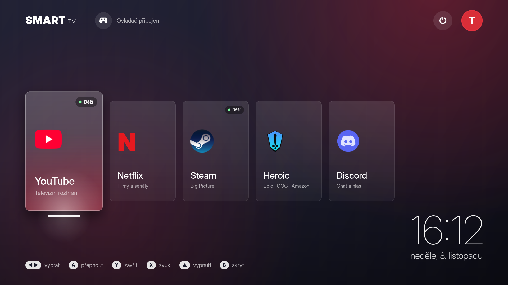
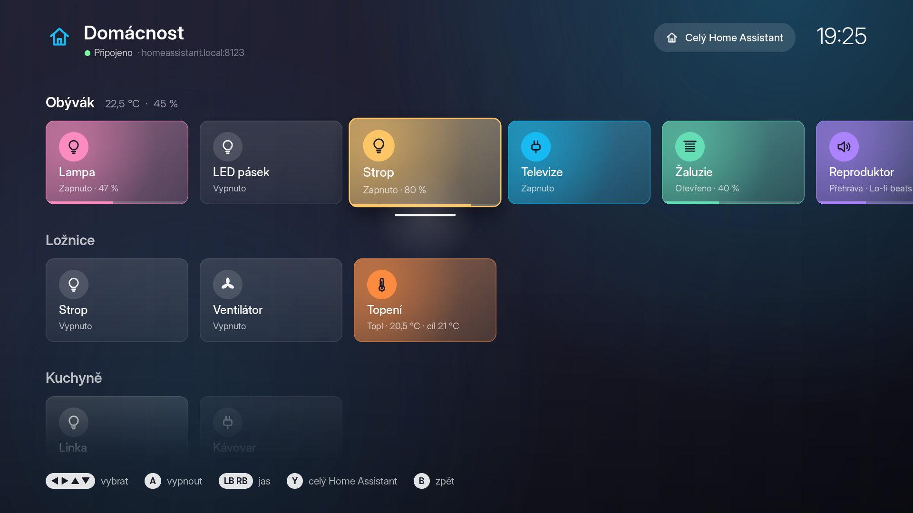

# Linux Smart TV

*[English](README.md)*



Udělá z linuxového počítače chytrou televizi. Zmáčkni **Home** na ovladači a objeví se hlavní obrazovka v televizním stylu: vysoké skleněné karty **YouTube**, **Netflix**, **Steam**, **Heroic**, **Discord** a **Domácnost** (Home Assistant) nad rozmazanou tapetou tvé plochy, velké hodiny a tlačítko vypnutí. Všechno je animované (karty naletí, vybraná se zvětší a rozsvítí, pozadí se zabarví podle aplikace) a kreslí to grafická karta, takže to běží plynule i na 4K. Celé to ovládáš jen ovladačem, i uvnitř YouTube, Netflixu a Discordu.

Funguje dvěma způsoby:

- **v běžném GNOME**: program běží na pozadí a Home otevře TV obrazovku přes celou plochu,
- **jako samostatná relace „Smart TV“** na přihlašovací obrazovce: po přihlášení naskočí rovnou TV, žádný desktop.

Nahrazuje [Gamepad Launcher](https://github.com/knespii/gamepad-launcher): umí všechno co on a instalace ho vypne.

## Jak to funguje

- Malý program na pozadí čte ovladač přímo z `/dev/input`.
- **YouTube** se otevře v Google Chrome přes celou obrazovku v televizním rozhraní YouTube (to, co mají chytré televize), které je dělané pro šipky.
- **Netflix** se otevře v Google Chrome přes celou obrazovku.
- YouTube a Netflix mají každý svůj Chrome profil, takže přihlášení zůstane a nemíchá se s tvým běžným Chromem.
- Webové stránky ani Discord ovladač neumí, takže když jsou v popředí, Smart TV převádí ovladač na **klávesnici a myš** (přes virtuální zařízení `/dev/uinput`).
- Steam a Heroic ovladač umí, ty ho dostanou přímo.
- **Discord** neumí startovat přes celou obrazovku a GNOME na Waylandu nedovolí cizímu programu jeho okno aktivovat ani zvětšit. Smart TV ho proto spouští přes XWayland (`--ozone-platform=x11`): jakmile se načte, vytáhne jeho okno dopředu a dá ho přes celou obrazovku, a totéž při každém návratu z hlavní obrazovky. Pokud Discord už běžel, spuštěný mimo Smart TV, Smart TV ho jednou restartuje (případný hovor se přeruší).
- **Domácnost** otevře vlastní panel Smart TV pro Home Assistant: místnosti jako řádky velkých dlaždic se světly, zásuvkami, žaluziemi, termostaty, reproduktory, zámky a scénami. S Home Assistantem mluví přímo přes jeho WebSocket API a mění se živě. Z panelu se dá otevřít i celé webové rozhraní Home Assistantu v Chromu.
- Najednou běží jen jedna streamovací aplikace, jako na televizi: spuštění Netflixu zavře YouTube.
- Ovladač můžeš kdykoli odpojit a znovu připojit, Smart TV ho najde sám.

## Ovládání

### Na hlavní obrazovce

| Tlačítko | Akce |
|---|---|
| **Home** | otevřít / zavřít hlavní obrazovku |
| **Home podržet 1 s** | otevřít hlavní obrazovku, když běží Steam (krátký stisk patří Steamu) |
| **◀ ▶** (D-pad, levá páčka, LB/RB) | výběr |
| **▲** | přejít na tlačítko vypnutí vpravo nahoře (**▼** zpět na aplikace) |
| **A** nebo **Start** | spustit, nebo přepnout do běžící aplikace |
| **Y** | zavřít vybranou běžící aplikaci |
| **X** | ovládací centrum (hlasitost, přehrávání) |
| **Select** (View) | rovnou otevřít menu Vypnout |
| **B** | zpět / skrýt hlavní obrazovku |

Hlavní obrazovka jde ovládat i myší a klávesnicí (šipky, Enter, Esc, Y nebo Delete).

### Klávesové zkratky

Když nemáš po ruce ovladač (v běžném GNOME):

| Klávesy | Co udělá |
|---|---|
| **Super+Alt+T** | otevře / zavře hlavní obrazovku |
| **Super+Alt+H** | otevře / zavře panel Domácnost (Home Assistant) |

Nekolidují se zkratkami GNOME ani běžných rozšíření; `./install.sh` navíc zkontroluje, že klávesy nejsou obsazené, a když jsou, nechá zkratku bez kláves. Jsou to běžné vlastní zkratky, takže je změníš v *Nastavení → Klávesnice → Vlastní zkratky*. Hlavní obrazovka se pak ovládá šipkami, Enter, Esc a Y; panel Domácnost šipkami, Enter (přepnout), + / − (jas atd.), Y (celý Home Assistant) a Esc (zpět).

### V YouTube, Netflixu a Discordu

| Ovladač | Funguje jako |
|---|---|
| D-pad, levá páčka | šipky |
| **A** | Enter |
| **B** | Esc (zpět) |
| **X** | mezerník (pauza) |
| **Y** | F (celá obrazovka); v Discordu přepne celou obrazovku / okno |
| **LB** / **RB** | Shift+Tab / Tab (skákání mezi tlačítky) |
| pravá páčka | kurzor myši |
| **RT** nebo stisk pravé páčky | levé tlačítko myši |
| **LT** | pravé tlačítko myši |
| **Select** (View) | klávesnice na obrazovce |
| **Start** (Menu) | ovládací centrum (hlasitost, přehrávání) |
| **Home** | zpět na hlavní obrazovku |

### Ovládací centrum

Panel přes běžící aplikaci, video hraje dál. V YouTube, Netflixu a Discordu ho otevřeš tlačítkem **Start**, odkudkoli jinde (třeba ve Steamu nebo ve hře) přes hlavní obrazovku tlačítkem **X**. Ukazuje, co se přehrává (náhled videa, název, kanál, časovou osu), a ovládá hlasitost, ztlumení, výstup zvuku (reproduktory / monitor přes HDMI / sluchátka) a přehrávání.

| Tlačítko | Akce |
|---|---|
| **◀ ▶** | vybrat ovládací prvek |
| **▲ ▼** | hlasitost (podržením plynule) |
| **A** | potvrdit (na − / + podržením plynule) |
| **X** | pauza / přehrát |
| **Y** | ztlumit |
| **LB** / **RB** | předchozí / další video |
| **B** nebo **Start** | zavřít |

Co se přehrává, se zjišťuje přes MPRIS (Chrome ho poskytuje pro YouTube i Netflix); když aplikace nic nehlásí, ovládací centrum ukáže jen zvuk. Hlasitost jde přes PipeWire (`wpctl`, `pactl`).

### Klávesnice na obrazovce

V YouTube, Netflixu a Discordu ji otevřeš tlačítkem **Select**. Vyjede zespodu jako na televizi: text píšeš do jejího políčka a **Hotovo** ho vloží do aplikace (kam právě míří kurzor, třeba do chatu nebo vyhledávání), **Odeslat** ho vloží a zmáčkne Enter (v Discordu odešle zprávu).

| Tlačítko | Akce |
|---|---|
| D-pad / levá páčka | pohyb po klávesách (podržením se opakuje) |
| **A** | napsat vybranou klávesu |
| **B** | smazat znak (podržením maže dál) |
| **X** | mezera |
| **Y** | velké písmeno (dvakrát = velká písmena trvale) |
| **LB** / **RB** | přepnout znaky: `abc`, `čšř`, `?123` |
| **Start** | odeslat (vložit + Enter) |
| **Select** | zavřít bez psaní |

Psát jde i na opravdové klávesnici. Text se vkládá přes schránku (Ctrl+V); tvůj původní obsah schránky se po vložení zase vrátí. YouTube má v televizním rozhraní vlastní klávesnici, tam se schránka nemusí chytit.

### Domácnost (Home Assistant)



Otevřeš ho kartou **Domácnost**. Každá místnost (oblast) z Home Assistantu je jeden řádek, vedle názvu je její teplota a vlhkost. Zařízení patří do místnosti přímo nebo přes své zařízení; scény, skripty a tlačítka bez místnosti jsou v řádku *Scény a skripty*, ostatní bez místnosti v *Ostatní*. Skryté entity a entity nastavení / diagnostiky se nezobrazí, nedostupné jsou zašedlé. Zapnutá dlaždice svítí barvou zařízení (barevná žárovka svou vlastní barvou) a proužek dole ukazuje jas, polohu nebo hlasitost.

| Tlačítko | Co udělá |
|---|---|
| D-pad / levá páčka | výběr dlaždice (při podržení opakuje) |
| **A** | světlo, zásuvka, ventilátor: zapnout / vypnout; žaluzie: otevřít / zavřít / zastavit; termostat: zapnout / vypnout; reproduktor: přehrát / pauza; scéna, skript, tlačítko: spustit; zámek: zamknout / odemknout (nejdřív se zeptá, provede to až druhé **A**) |
| **LB** / **RB** | méně / víc (podržením plynule): jas, poloha žaluzií, cílová teplota, hlasitost, rychlost ventilátoru |
| **▲** na prvním řádku | tlačítko *Celý Home Assistant* (webové rozhraní) |
| **Y** | celé webové rozhraní Home Assistantu v Chromu |
| **B** nebo **Home** | zpět na hlavní obrazovku |

Změna se ukáže hned a Home Assistant ji vzápětí potvrdí. Panel je připojený jen když je otevřený (a minutu potom, aby další otevření bylo okamžité).

### Menu Vypnout

Otevřeš ho tlačítkem vypnutí vpravo nahoře (**▲** a **A**) nebo tlačítkem **Select**.

- **Uspat**
- **Vypnout PC**: ptá se na potvrzení, první **A** dlaždici zčervená, druhé **A** PC vypne
- **Zavřít vše**: ukončí Steam, Heroic, Discord, YouTube i Netflix
- **Do GNOME** (jen v relaci Smart TV): odhlásí tě, na přihlašovací obrazovce pak vybereš GNOME

## První přihlášení

Přihlášení děláš jen jednou, pak si ho Chrome pamatuje.

- **YouTube**: v televizním rozhraní vyber *Přihlásit se*. Ukáže kód, ten zadáš v telefonu na [youtube.com/activate](https://youtube.com/activate).
- **Netflix**: e-mail a heslo napiš na klávesnici (ovladačem se text píše špatně).
- **Discord**: přihlášení QR kódem z aplikace Discord v telefonu.

### Připojení Home Assistantu

Panel potřebuje adresu tvého Home Assistantu a dlouhodobý přístupový token:

1. V Home Assistantu otevři svůj profil (vlevo dole), záložku *Zabezpečení* a dole u *Dlouhodobé přístupové tokeny* vytvoř token.
2. Vlož ho do `~/.config/smart-tv/homeassistant.conf` (vytvoří ho `./install.sh`, číst ho můžeš jen ty) a zkontroluj adresu:

   ```
   url = https://homeassistant.local:8123
   token = eyJhbGciOi...
   ```

3. Otevři kartu *Domácnost* znovu.

Volitelně ve stejném souboru: `favorites = light.obyvak, scene.kino` (napřed řádek *Oblíbené*), `hide = switch.neco` (nezobrazí se), `verify_ssl = no` (certifikát podepsaný sám sebou). Bez tokenu ti tyhle kroky ukáže přímo panel. Celé webové rozhraní (**Y**) má vlastní Chrome profil, přihlásíš se v něm jednou.

## Požadavky

- Linux se systemd a GNOME (testováno na Debianu 13, GNOME 48, Wayland)
- Python 3 s GTK 4 (`python3-gi`, `gir1.2-gtk-4.0`), na GNOME už je
- `wl-clipboard` (pro vkládání textu z klávesnice na obrazovce)
- písmo Inter (`fonts-inter`) vypadá nejlíp, jinak se použije Cantarell
- uživatel ve skupině `input` (čtení ovladače a virtuální klávesnice přes `/dev/uinput`)
- **Google Chrome** z deb balíčku (`google-chrome`), jen v něm jede Netflix
- Steam (`steam`), Heroic a Discord jako Flatpak (`com.heroicgameslauncher.hgl`, `com.discordapp.Discord`)
- Home Assistant (nepovinné), dostupný z počítače

Testováno s ovladačem **8BitDo Ultimate 2C Wireless**. Mělo by fungovat s jakýmkoli ovladačem, který posílá tlačítko `BTN_MODE` (Xbox, PlayStation a další).

## Instalace

```bash
git clone https://github.com/knespii/linux-smart-tv.git
```

```bash
cd linux-smart-tv && ./install.sh
```

Pokud nejsi ve skupině `input`:

```bash
sudo usermod -aG input $USER
```

Pak se odhlas a znovu přihlas a spusť `./install.sh` znovu.

### Relace „Smart TV“ na přihlašovací obrazovce

Potřebuje `sudo`, nainstaluje balíčky `gnome-kiosk` a `gnome-kiosk-script-session` a přidá relaci „Smart TV“:

```bash
./install-session.sh
```

Pak se odhlas, na přihlašovací obrazovce klikni na své jméno, vpravo dole na ozubené kolečko vyber **Smart TV** a přihlas se. Zpátky do GNOME se dostaneš přes **Vypnout → Do GNOME**.

## Odinstalace

```bash
./uninstall.sh
```

Zapne zpátky Gamepad Launcher, pokud byl nainstalovaný. Přihlášení do YouTube a Netflixu nechá v `~/.local/share/smart-tv/profiles`, nastavení Home Assistantu v `~/.config/smart-tv`. Relaci z přihlašovací obrazovky odebereš:

```bash
sudo rm /usr/share/wayland-sessions/smart-tv.desktop
```

## Úpravy

Aplikace jsou na začátku souboru `smart_tv.py` v seznamu `APPS`, menu Vypnout v seznamu `POWER`. Barvy a velikosti dlaždic panelu Domácnost jsou na začátku `ha_view.py`, jeho nastavení v `~/.config/smart-tv/homeassistant.conf`. Vzhled (barvy aplikací, velikosti karet, délky animací) je na začátku `home_view.py`. Pozadí je rozmazaná tapeta z GNOME a avatar tvůj obrázek účtu. Třeba Twitch přidáš takhle:

```python
{
    "id": "twitch", "name": "Twitch", "theme": "discord",
    "sub": "Živé přenosy",
    "kind": "web", "url": "https://www.twitch.tv",
    "glyph": "T", "pad": "keys",
},
```

Po úpravě spusť znovu `./install.sh`.

### Užitečné příkazy

```bash
systemctl --user status smart-tv
```

```bash
journalctl --user -u smart-tv -f
```

V relaci Smart TV běží program jako služba `org.gnome.Kiosk.Script`:

```bash
journalctl --user -u org.gnome.Kiosk.Script -f
```

## Na co je dobré vědět

- Token Home Assistantu dává plný přístup k tvému Home Assistantu. Je uložený jen v `~/.config/smart-tv/homeassistant.conf`, který můžeš číst jen ty; zrušíš ho smazáním tokenu v profilu Home Assistantu.
- **Netflix jede v Chrome na Linuxu nejvýš v 720p.** Je to omezení Netflixu, nejde obejít.
- YouTube pozná televizi podle „user-agenta“. Kdyby jednou místo televizního rozhraní ukázal běžný web, stačí v `smart_tv.py` změnit `TV_USER_AGENT`.
- Když přepneš na YouTube nebo Netflix, které už běží v pozadí, načtou se znovu (na Waylandu nejde cizí okno vytáhnout dopředu). Steam, Heroic a Discord se jen přepnou.

## Nároky na výkon

Skoro žádné. Program většinu času spí, probudí se při stisku tlačítka a každé 2 s zkontroluje nově připojený ovladač. Hlavní obrazovka kreslí jen během animací (pak stojí), spojení s Home Assistantem je otevřené jen když panel používáš a do her nijak nezasahuje.

## Licence

MIT
