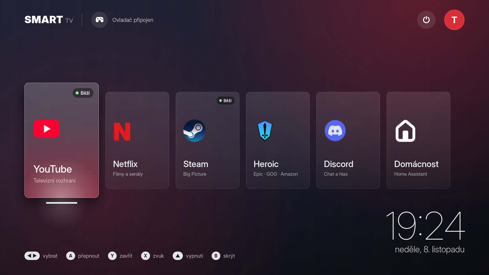
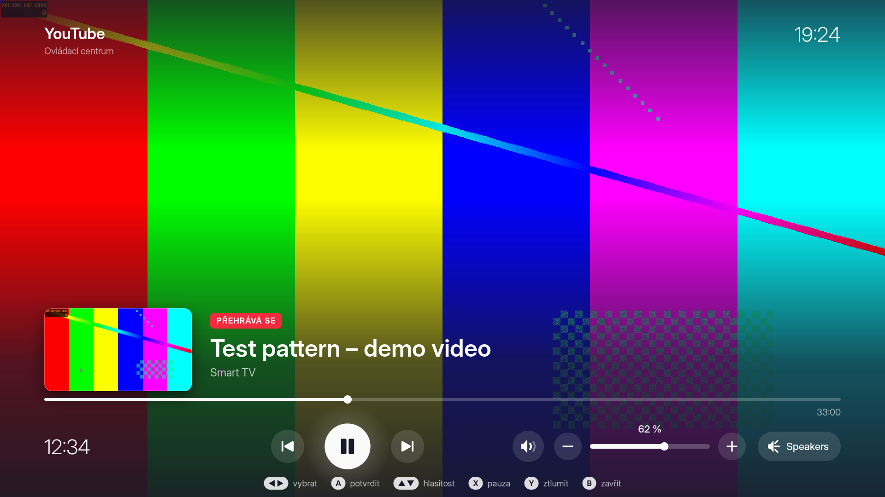
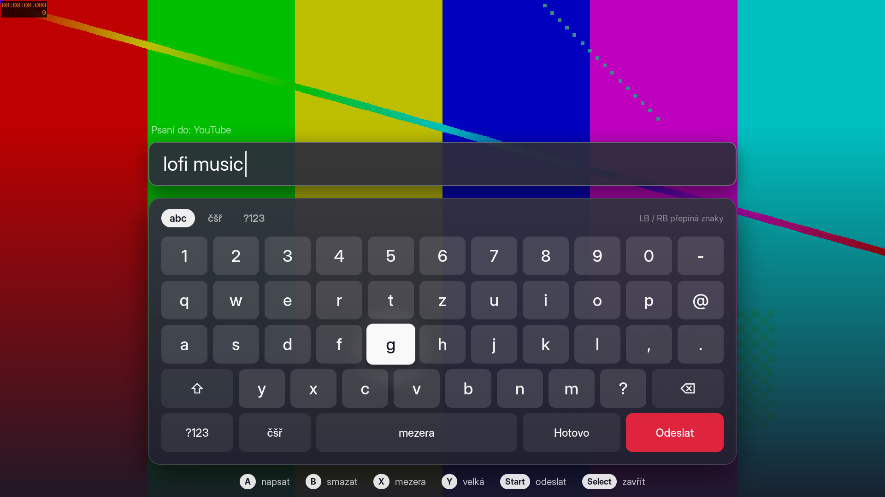
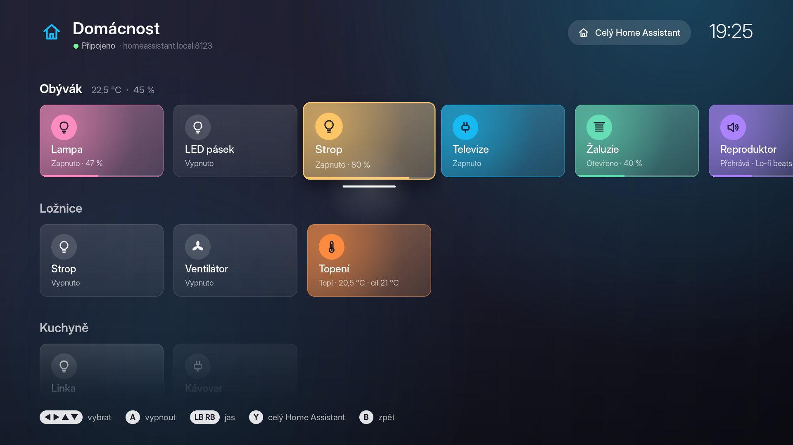

# Linux Smart TV

*[Česky](README.cs.md)*

Turn a Linux PC into a smart TV you control with a gamepad. Press **Home** on the controller and a TV-style home screen appears: tall glass cards for **YouTube**, **Netflix**, **Steam**, **Heroic**, **Discord** and your **Home Assistant** smart home over a blurred copy of your wallpaper, a big clock and a power button. Everything is animated (cards fly in, the selected one grows and lights up, the background takes the app's color) and drawn on the GPU, so it stays smooth on a 4K screen. The gamepad works everywhere, even inside YouTube, Netflix and Discord.



| Control center over a playing video | On-screen keyboard |
|---|---|
|  |  |



It runs in two ways:

- **in your normal GNOME session**: a small background service; Home opens the TV screen over the desktop,
- **as its own "Smart TV" login session**: pick it on the login screen and you get the TV screen straight away, no desktop.

The user interface is in Czech (texts are at the top of `smart_tv.py` and in the view files).

## How it works

- A small background program reads the gamepad straight from `/dev/input`.
- **YouTube** opens fullscreen in Google Chrome with YouTube's TV interface (the one smart TVs use), which is made for arrow keys.
- **Netflix** opens fullscreen in Google Chrome.
- YouTube and Netflix each get their own Chrome profile, so you stay signed in and it doesn't mix with your everyday Chrome. Chrome is always closed gracefully, so logins are saved.
- Web pages and Discord don't understand a gamepad, so while they're in front, Smart TV turns the gamepad into a **keyboard and mouse** (a virtual `/dev/uinput` device).
- Steam and Heroic support gamepads themselves and get it directly.
- **Discord** can't start fullscreen, and on Wayland GNOME doesn't let one program focus or resize another one's window. So Smart TV starts Discord on XWayland (`--ozone-platform=x11`): once it's loaded, its window is brought to front and made fullscreen, and again every time you return to it. If Discord was already running (started outside Smart TV), it is restarted once (a call would drop).
- **Home Assistant** (the *Domácnost* card) opens Smart TV's own panel: your rooms as rows of big tiles with lights, switches, covers, thermostats, media players, locks and scenes. It talks to Home Assistant directly over its WebSocket API and updates live. The full Home Assistant web UI opens from the panel in Chrome.
- Only one streaming app runs at a time, like on a TV: starting Netflix closes YouTube.
- You can unplug and replug the gamepad any time, Smart TV finds it again.

## Controls

### Home screen

| Button | Action |
|---|---|
| **Home** | open / close the home screen |
| **Hold Home 1 s** | open the home screen while Steam runs (a short press belongs to Steam) |
| **◀ ▶** (D-pad, left stick, LB/RB) | select |
| **▲** | go to the power button, top right (**▼** back to the apps) |
| **A** or **Start** | launch, or switch to the running app |
| **Y** | close the selected running app |
| **X** | control center (volume, playback) |
| **Select** (View) | power menu |
| **B** | back / hide the home screen |

The home screen also works with a mouse and keyboard (arrows, Enter, Esc, Y or Delete).

### Inside YouTube, Netflix and Discord

| Gamepad | Acts as |
|---|---|
| D-pad, left stick | arrow keys |
| **A** | Enter |
| **B** | Esc (back) |
| **X** | Space (pause) |
| **Y** | F (fullscreen); in Discord toggles fullscreen / window |
| **LB** / **RB** | Shift+Tab / Tab (jump between buttons) |
| right stick | mouse pointer |
| **RT** or right stick click | left mouse button |
| **LT** | right mouse button |
| **Select** (View) | on-screen keyboard |
| **Start** (Menu) | control center (volume, playback) |
| **Home** | back to the home screen |

### Control center

A panel over the running app; the video keeps playing behind it. Open it with **Start** in YouTube, Netflix and Discord, or from anywhere else (Steam, a game) with **X** on the home screen. It shows what's playing (thumbnail, title, channel, progress) and controls the volume, mute, audio output (speakers / HDMI monitor / headphones) and playback.

| Button | Action |
|---|---|
| **◀ ▶** | select a control |
| **▲ ▼** | volume (hold for continuous) |
| **A** | press (hold on − / + for continuous) |
| **X** | pause / play |
| **Y** | mute |
| **LB** / **RB** | previous / next video |
| **B** or **Start** | close |

What's playing comes from MPRIS (Chrome provides it for YouTube and Netflix); if the app reports nothing, the control center shows just the audio controls. Volume goes through PipeWire (`wpctl`, `pactl`).

### On-screen keyboard

Open it with **Select** in YouTube, Netflix and Discord. It slides up like on a TV: you type into its own field, **Hotovo** (Done) puts the text into the app (wherever the cursor is, e.g. a chat or a search box), **Odeslat** (Send) puts it in and presses Enter (sends the message in Discord).

| Button | Action |
|---|---|
| D-pad / left stick | move between keys (repeats while held) |
| **A** | type the selected key |
| **B** | delete a character (keeps deleting while held) |
| **X** | space |
| **Y** | capital letter (twice = caps lock) |
| **LB** / **RB** | switch layers: `abc`, `čšř` (Czech letters), `?123` |
| **Start** | send (paste + Enter) |
| **Select** | close without typing |

A real keyboard works too. The text is pasted through the clipboard (Ctrl+V), and your previous clipboard content is put back afterwards. YouTube's TV interface has its own keyboard; pasting may not work there.

### Home Assistant panel

Open it with the **Domácnost** card. Every room (area) of your Home Assistant is a row, with its temperature and humidity next to its name. Devices belong to a room directly or through their device; scenes, scripts and buttons without a room are in *Scény a skripty*, everything else without a room in *Ostatní*. Hidden entities and settings / diagnostic entities are left out, unavailable ones are dimmed. A tile lights up in the device's color while it's on (an RGB bulb in its own color), and a bar at its bottom shows brightness, position or volume.

| Button | Action |
|---|---|
| D-pad / left stick | select a tile (repeats while held) |
| **A** | light, switch, fan: on / off; cover: open / close / stop; thermostat: on / off; media player: play / pause; scene, script, button: run; lock: lock / unlock (asks first, the second **A** does it) |
| **LB** / **RB** | less / more (hold for continuous): brightness, cover position, target temperature, volume, fan speed |
| **▲** on the first row | the *Celý Home Assistant* button (the full web UI) |
| **Y** | full Home Assistant web UI in Chrome |
| **B** or **Home** | back to the home screen |

A change shows at once and Home Assistant confirms it a moment later. The panel only stays connected while it's open (and a minute after, so opening it again is instant).

### Power menu

Open it with the power button at the top right (**▲**, then **A**) or with **Select**.

- **Uspat** (Suspend)
- **Vypnout PC** (Power off): asks for confirmation, the first **A** turns the tile red, the second **A** powers off
- **Zavřít vše** (Close all): quits Steam, Heroic, Discord, YouTube and Netflix
- **Do GNOME** (only in the Smart TV session): logs out, so you can pick GNOME on the login screen

## First sign-in

You sign in only once, Chrome remembers it.

- **YouTube**: choose *Sign in* in the TV interface. It shows a code; enter it at [youtube.com/activate](https://youtube.com/activate) on your phone or in your normal browser.
- **Netflix**: type your e-mail and password with a keyboard (or the on-screen keyboard).
- **Discord**: sign in with the QR code from the Discord phone app.

### Connecting Home Assistant

The panel needs your Home Assistant's address and a long-lived access token:

1. In Home Assistant, open your profile (bottom left), the *Security* tab, and under *Long-lived access tokens* create a token.
2. Put it into `~/.config/smart-tv/homeassistant.conf` (`./install.sh` creates it, only you can read it), and check the address:

   ```
   url = https://homeassistant.local:8123
   token = eyJhbGciOi...
   ```

3. Open the *Domácnost* card again.

Optional settings in the same file: `favorites = light.living_room, scene.movie` (a *Oblíbené* row first), `hide = switch.something` (never shown), `verify_ssl = no` (self-signed certificate). Without a token the panel shows these steps itself. The full web UI (**Y**) has its own Chrome profile, you sign in there once.

## Requirements

- Linux with systemd and GNOME (tested on Debian 13, GNOME 48, Wayland)
- Python 3 with GTK 4 (`python3-gi`, `gir1.2-gtk-4.0`), already there on GNOME
- `wl-clipboard` (to paste text from the on-screen keyboard)
- the Inter font (`fonts-inter`) looks best, Cantarell is used otherwise
- your user in the `input` group (reading the gamepad and the virtual keyboard through `/dev/uinput`)
- **Google Chrome** from the deb package (`google-chrome`), the only browser Netflix runs in
- Steam (`steam`), Heroic and Discord as Flatpaks (`com.heroicgameslauncher.hgl`, `com.discordapp.Discord`)
- Home Assistant (optional), reachable from the PC

No extra Python packages and no root for the basic install.

Tested with an **8BitDo Ultimate 2C Wireless** controller. It should work with any controller that sends the `BTN_MODE` button (Xbox, PlayStation and others).

## Install

```bash
git clone https://github.com/knespii/linux-smart-tv.git
```

```bash
cd linux-smart-tv && ./install.sh
```

If you're not in the `input` group:

```bash
sudo usermod -aG input $USER
```

Then log out, log back in and run `./install.sh` again.

Smart TV replaces [Gamepad Launcher](https://github.com/knespii/gamepad-launcher): it does everything that one does, and the install switches it off (its files stay).

### "Smart TV" login session

Needs `sudo`: installs the `gnome-kiosk` and `gnome-kiosk-script-session` packages and adds a "Smart TV" session:

```bash
./install-session.sh
```

Then log out, click your name on the login screen, pick **Smart TV** under the gear icon at the bottom right and log in. Get back to GNOME with **Power → Do GNOME**.

## Uninstall

```bash
./uninstall.sh
```

Turns Gamepad Launcher back on if it was installed. YouTube and Netflix logins stay in `~/.local/share/smart-tv/profiles`, the Home Assistant settings in `~/.config/smart-tv`. Remove the login-screen session with:

```bash
sudo rm /usr/share/wayland-sessions/smart-tv.desktop
```

## Customizing

The apps are in the `APPS` list at the top of `smart_tv.py`, the power menu in `POWER`. The Home Assistant panel's tile colors and sizes are at the top of `ha_view.py`, its settings in `~/.config/smart-tv/homeassistant.conf`. The look (app colors, card sizes, animation lengths) is at the top of `home_view.py`. The background is your blurred GNOME wallpaper and the avatar is your account picture. Adding Twitch, for example:

```python
{
    "id": "twitch", "name": "Twitch", "theme": "discord",
    "sub": "Live streams",
    "kind": "web", "url": "https://www.twitch.tv",
    "glyph": "T", "pad": "keys",
},
```

Run `./install.sh` again after a change.

### Useful commands

```bash
systemctl --user status smart-tv
```

```bash
journalctl --user -u smart-tv -f
```

In the Smart TV session the program runs as the `org.gnome.Kiosk.Script` service:

```bash
journalctl --user -u org.gnome.Kiosk.Script -f
```

## Good to know

- **Netflix in Chrome on Linux plays at 720p at most.** That's a Netflix limit and can't be worked around.
- YouTube recognizes a TV by its user agent. If it ever shows the normal website instead of the TV interface, change `TV_USER_AGENT` in `smart_tv.py`.
- Switching to YouTube or Netflix while it runs in the background reloads it (on Wayland another program's window can't be raised from outside). Steam, Heroic and Discord just come to front.
- The Home Assistant token gives full access to your Home Assistant. It's stored only in `~/.config/smart-tv/homeassistant.conf`, readable just by you; delete the token in your Home Assistant profile to revoke it.
- The control center and the on-screen keyboard are maximized windows, not fullscreen ones: GNOME draws fullscreen windows as opaque, which would hide the video behind them.

## Resource use

Almost none. The program sleeps most of the time, wakes up on a button press and checks for a newly connected gamepad every 2 s. The home screen only draws while something animates, the Home Assistant connection is only open while you use the panel, and nothing touches your games.

## License

MIT
